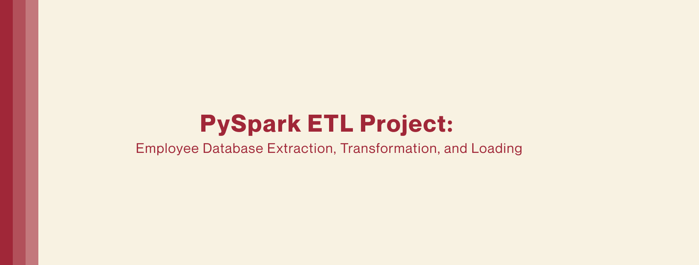

## Overview

- This project is a ETL (Extract, Transform, Load) project that demonstrates the process of extracting data from an employee database using Apache Spark, performing various transformations, and finally loading the processed data into a MySQL database Postgres, Snowflake, AWS S3 and S3 Iceberg based on config json provided. The entire process is implemented in Python, and JSON is used for configuration to enhance modularity and maintainability.

## Table of Contents

- [Introduction](#overview)
- [Installation](#installation)
- [Usage](#usage)
- [Configuration](#configuration)
- [Transformation](#transformation)
- [Error Handling](#error-handling)
- [Technologies Used](#technologies-used)
- [Contributing](#contributing)
- [License](#license)

## Installation

1.  Clone this repository to your local machine:

        git clone https://github.com/your-username/pyspark-etl.git
        cd pyspark-etl

2.  Install the required dependencies:

        pip install -r requirements.txt

3.  Setup MySQL database and adjust the connection configuration in Json_Folder

## Usage

- To run the Spark ETL process, execute the following command in your terminal:

        python -m src/ Spark_Initializer.py

        python -m src/ extract.py

        python -m src/ transform.py

        python -m src/ load.py

- To run the Spark ETL process, execute the following command in your terminal:

        python -m src/read_data.py

These scripts will use Apache Spark to extract data from the employee database, perform transformations as specified in the configuration, and load the processed data into the MySQL database.

## Configuration

The project utilizes a JSON configuration files to specify the Spark ETL process. This allows for easy customization without modifying the code directly. The configuration includes the following parameters:

- Database connection details
- Tables to extract
- Transformation tasks (date format change, column split, column rename, column concatenation, column dropping, etc.)

## Transformation

The Spark ETL process involves the following transformation steps on the extracted data:

- Date Format Change: Convert date columns to a consistent date format.
- Column Split: Split specified columns into multiple columns as required.
- Column Concatenation: Combine multiple columns to create new composite columns.
- Column Dropping: Remove unnecessary columns that are not required in the final dataset.
- Table Join: Combine data from multiple tables to create a unified dataset.
- Calculate Tenure : Function to calculate tenure and set the value in new column.
- Filter Rows: Perform filter operation in dataset with condition expression.
- Fill Missing Values: Fill-in null or empty values with defined data string.
- Normalize Strings: Performs string normalization.

## Error Handling

The project implements robust error handling using Spark's fault-tolerant features to ensure smooth execution even in the presence of unexpected scenarios. Error logs are generated for debugging purposes and to track potential issues during the Spark ETL process.

## Technologies Used

- Python: Programming language used for implementing the Spark ETL process.
- Apache Spark: Distributed data processing framework used for scalable ETL operations.
- JSON: Configuration files are written in JSON format for easy customization.
- MySQL: The final processed data is loaded into a MySQL database.
- Snowflake : Option to load the final processed data is loaded into a Snowflake.
- Parquet: The extracted data is saved in Parquet file format, which is optimized for performance and space efficiency.
- Postgres : Option to load data into postgres
- S3 Parquet : Option to load final data as parquet file and move to s3 bucket
- Iceberg : Option to load final data as Iceberg table to s3 bucket

## Contributing

I welcome contributions from the community! If you find any issues or have suggestions for improvements, please feel free to open an issue or submit a pull request.

## License

This project is licensed under the MIT License - see the [LICENSE](LICENSE) file for details.

---
